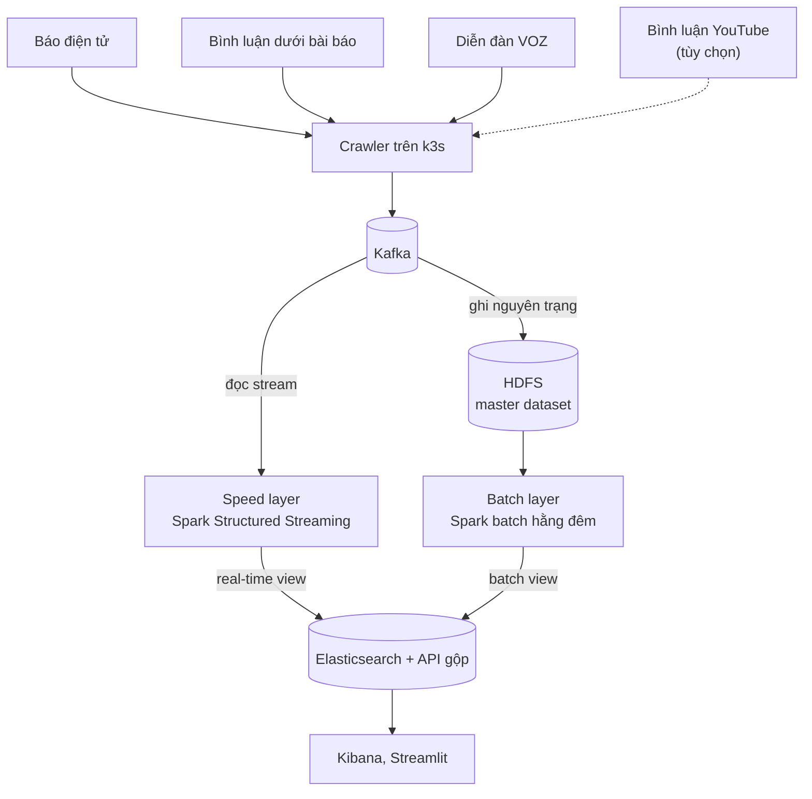

# VietPulse: Plan and Tracker

> Cập nhật lần cuối: 11/10/2026 · Trưởng nhóm: Thái · Thành viên: Thái, Thạch, Thắng, Quang, Đạt

Tài liệu này gồm hai phần: kế hoạch (thiết kế và lịch 10 tuần) và phần theo dõi tiến độ hằng tuần ở cuối file.

## 1. Mục tiêu và phạm vi

Trong 10 tuần, nhóm 5 người xây VietPulse: pipeline Lambda trên k3s phân tích cảm xúc và chủ đề từ báo điện tử, bình luận dưới bài báo và diễn đàn VOZ, kèm báo cáo 4 phần theo guideline môn IT4043E. Bình luận YouTube là phần tùy chọn.

**Trong phạm vi:**

- 3 nguồn bắt buộc: bài báo, bình luận dưới bài báo, VOZ, kèm backfill lịch sử.
- Speed layer, batch layer, serving layer gộp theo mốc T, dashboard Kibana và Streamlit.
- Đủ 6 nhóm yêu cầu Spark của guideline.
- Triển khai trên k3s, giám sát bằng Prometheus, Grafana và Loki.

**Tùy chọn:**

- Bình luận YouTube, chỉ làm khi các việc bắt buộc của M4 đã xong. Thiết kế vẫn chừa sẵn chỗ (giá trị source, Kafka topic) để thêm nguồn này mà không phải sửa pipeline.

**Ngoài phạm vi:**

- Huấn luyện PhoBERT từ đầu; nhóm chỉ fine-tune hoặc dùng model có sẵn.
- Ứng dụng cho người dùng cuối, đăng nhập và phân quyền phức tạp.
- Triển khai trên cloud trả phí.

**Tiêu chí thành công** (mục tiêu đề xuất, đo lại khi chạy thật):

| Tiêu chí | Mục tiêu |
| --- | --- |
| Độ trễ speed layer, từ lúc crawl đến dashboard | dưới 5 phút |
| Chuỗi batch hằng đêm | xong trước 7h sáng |
| Khối lượng master dataset | từ vài triệu bản ghi trở lên |
| Mất dữ liệu khi kill pod Spark | 0 bản ghi, kiểm bằng đối soát |
| Lessons Learned | mỗi thành viên ít nhất 1 bài, phủ ít nhất 6 nhóm chủ đề |

## 2. Kiến trúc tổng quan

Kafka là điểm vào duy nhất. Speed layer cho kết quả nhanh nhưng gần đúng, batch layer tính lại đầy đủ mỗi đêm, và serving layer gộp hai view theo mốc T.



## 3. Hợp đồng dữ liệu

Mọi thành phần giao tiếp qua 4 hợp đồng dưới đây. Đổi một hợp đồng phải qua PR được người phụ trách của cả hai phía đồng ý và Thái review.

### Envelope chung cho mọi bản ghi trong Kafka

| Trường | Kiểu | Ý nghĩa |
| --- | --- | --- |
| source | string | news_article, news_comment, voz_post; youtube_comment nếu làm phần tùy chọn |
| record_id | string | id gốc ở nguồn; key Kafka = source + record_id |
| event_time | timestamp UTC | thời điểm bài hoặc bình luận được viết |
| ingest_time | timestamp UTC | thời điểm crawler lấy về |
| schema_version | int | tăng khi đổi cấu trúc payload |
| payload | JSON | trường riêng của từng nguồn |

Mọi thời gian lưu theo UTC; chỉ đổi sang giờ Việt Nam khi hiển thị.

### Kafka topics

Số partition và thời gian giữ là giá trị khởi điểm, chỉnh sau khi đo.

| Topic | Partition | Giữ lại | Ai đọc |
| --- | --- | --- | --- |
| raw.news.articles | 3 | 7 ngày | raw-ingest, speed-sentiment |
| raw.news.comments | 6 | 7 ngày | raw-ingest, speed-sentiment |
| raw.forum.posts | 3 | 7 ngày | raw-ingest, speed-sentiment |
| raw.youtube.comments (tùy chọn) | 3 | 7 ngày | raw-ingest, speed-sentiment |
| raw.backfill | 6 | 2 ngày | raw-ingest |
| dlq.raw | 1 | 14 ngày | người vận hành |
| alerts.sentiment | 1 | 7 ngày | dịch vụ cảnh báo |

### Thư mục HDFS

```text
/vietpulse
├── raw/source=…/event_date=…   nguyên trạng từ Kafka
├── clean/       bảng đã khử trùng, chuẩn hóa, gắn nhãn
├── curated/     chỉ số ngày, khoảng cách, đồ thị thực thể
├── reference/   tag_alias, từ điển thực thể, taxonomy
├── models/      PhoBERT (ONNX), model MLlib
└── checkpoints/ checkpoint của job streaming
```

Bảng trong clean và curated được đăng ký ở Hive Metastore, partition theo event_date. Bảng bài viết và bình luận được bucket theo article_id để join không cần shuffle.

### Index Elasticsearch

| Index | Nội dung | Ghi bởi | Thời gian giữ |
| --- | --- | --- | --- |
| vp-rt-YYYY.MM.DD | tổng hợp theo cửa sổ thời gian | speed-sentiment | xóa khi batch view đã phủ |
| vp-batch-daily | chỉ số cảm xúc theo ngày | batch-publish | lâu dài |
| vp-docs | bài và bình luận đầy đủ để tìm kiếm | speed-sentiment (bản tạm), batch-publish (bản chuẩn) | lâu dài |
| vp-meta | mốc T của lần batch gần nhất | batch-publish | lâu dài |

## 4. Đặc tả Spark job

Hệ thống có 6 job: 2 job streaming chạy liên tục và 4 job batch. Mọi job import logic xử lý từ thư mục `common/`, để speed layer và batch layer không lệch nhau.

| Job | Kiểu và lịch | Đọc → Ghi | Đảm bảo | Phụ trách |
| --- | --- | --- | --- | --- |
| raw-ingest | streaming, ghi file mỗi 5–15 phút | Kafka raw.* và raw.backfill → /raw | không mất, không trùng (checkpoint + file sink) | Quang |
| speed-sentiment | streaming, micro-batch vài chục giây | Kafka raw.* → vp-rt-*, vp-docs, alerts.sentiment | watermark khởi điểm 2 giờ, upsert idempotent | Quang |
| batch-clean | hằng đêm, 1h | /raw của các ngày có dữ liệu mới → /clean | ghi đè theo partition, chạy lại an toàn | Đạt |
| batch-analytics | hằng đêm, sau batch-clean | /clean → /curated | ghi đè theo partition | Đạt, Thái |
| batch-publish | hằng đêm, sau batch-analytics | /curated → vp-batch-daily, vp-docs, vp-meta | mốc T chỉ cập nhật ở bước cuối | Đạt |
| reference-refresh | hằng tuần | /clean → /reference | nhóm duyệt trước khi áp dụng | Thái |

**Điều phối batch:** một CronJob chạy lúc 1h, submit lần lượt batch-clean → batch-analytics → batch-publish và chờ từng job xong. Nếu một bước lỗi, chuỗi dừng và mốc T giữ nguyên. Real-time view chưa bị xóa nên dashboard vẫn đúng.

**Dữ liệu đến muộn:** batch-clean không chỉ chạy partition hôm qua mà chạy lại mọi partition có bản ghi mới đến trong ngày. Nhờ ghi đè theo partition, chạy lại bao nhiêu lần cũng cho cùng kết quả.

## 5. Triển khai

Toàn bộ hệ thống chạy trên k3s, chia thành 6 namespace. Hai cấu hình single-node và multi-node dùng chung manifest qua Kustomize.

| Namespace | Thành phần | Cách cài |
| --- | --- | --- |
| ingestion | 3 crawler (Deployment, CronJob); crawler YouTube nếu làm phần tùy chọn | manifest tự viết |
| messaging | Kafka chế độ KRaft | Strimzi operator |
| storage | HDFS NameNode, DataNode; Hive Metastore + PostgreSQL | Helm chart, StatefulSet |
| processing | 6 Spark job | Spark Operator |
| serving | Elasticsearch, Kibana, API FastAPI, Streamlit | ECK operator, Deployment |
| monitoring | Prometheus, Grafana, Alertmanager, Loki | kube-prometheus-stack, Helm chart Loki |

- **Image:** 3 image (crawler, spark, api) được build bằng GitHub Actions và đẩy lên GHCR. Spark image cài sẵn jar Kafka, GraphFrames, Elasticsearch cùng thư viện Python.
- **Cấu hình:** thư mục `k8s/base` cùng hai overlay single-node và multi-node.
- **Bí mật:** mật khẩu Elasticsearch (và API key YouTube nếu làm phần tùy chọn) để trong Secret, không commit lên GitHub.
- **Truy cập:** Kibana, Grafana, API và Streamlit mở qua Traefik, là ingress có sẵn trong k3s.
- **Ổ đĩa:** k3s dùng local-path, nên pod giữ dữ liệu bị ghim vào một máy. Cấu hình multi-node dựa vào replication của Kafka, HDFS và Elasticsearch.
- **Môi trường dev:** `docker-compose.yml` chạy Kafka, Spark và Elasticsearch trên máy cá nhân để viết code trước khi lên k3s.

## 6. Kiểm thử và giám sát

Mỗi lớp của pipeline có kiểm thử riêng. Mọi kết quả đo được lưu lại làm số liệu cho Lessons Learned.

| Loại | Làm gì | Khi nào | Phụ trách |
| --- | --- | --- | --- |
| Unit | pytest cho `common/` (làm sạch, tách từ, gắn nhãn, chấm điểm) với SparkSession local | mỗi PR, qua GitHub Actions | người viết code |
| Tích hợp | trên Compose: crawler mẫu → Kafka → job → Elasticsearch, so số bản ghi ở hai đầu | trước khi merge một job mới | Quang |
| Chất lượng dữ liệu | kiểm schema, giá trị rỗng, bản trùng, tỉ lệ bản ghi vào dlq | mỗi đêm, trong batch-clean | Đạt |
| Đối soát | so batch view với real-time view của cùng một ngày | mỗi đêm, sau batch-publish | Thái |
| Chịu lỗi | kill pod Spark, Kafka broker, DataNode rồi kiểm không mất bản ghi | tuần 8–9 | Quang |
| Hiệu năng | so execution plan và thời gian chạy trước, sau tối ưu (bucketing, broadcast, cache) | tuần 7–9 | Đạt |
| Model | precision của gắn nhãn, F1 của sentiment trên mẫu gán tay | tuần 7 | Thái |

**Giám sát** (Thạch phụ trách):

- **Spark streaming:** số offset đang tụt, tốc độ vào và tốc độ xử lý, thời gian mỗi batch. Đẩy sang Prometheus qua StreamingQueryListener.
- **Kafka:** Kafka Exporter của Strimzi và dung lượng đĩa của broker.
- **Batch:** thời gian chạy từng job, và mốc T có tiến lên mỗi ngày không.

**Cảnh báo** (ngưỡng khởi điểm):

- raw-ingest dừng quá 30 phút.
- Số offset tụt tăng liên tục quá 15 phút.
- Chuỗi batch đêm thất bại.
- Đĩa của bất kỳ node nào vượt 80%.

## 7. Quyết định kiến trúc (ADR)

Có 8 quyết định: 2 đã chốt, 1 đang chờ xác nhận (chốt ở M1.3), 5 đang ở mức đề xuất cần nhóm đồng ý ở M1.2. Mỗi dòng ghi lý do chính để đưa thẳng vào phần Architecture and Design của báo cáo.

| Quyết định | Lựa chọn | Lý do chính | Trạng thái |
| --- | --- | --- | --- |
| Kiến trúc | Lambda | GraphFrames, huấn luyện MLlib và bucketing cần batch; bình luận đến muộn; đổi model chỉ cần chạy lại batch | Đã chốt |
| Nền tảng | k3s | nhẹ, ghép được nhiều máy, đáp ứng yêu cầu Kubernetes | Đã chốt |
| Message queue | Kafka KRaft qua Strimzi | giữ log cho nhiều consumer, replay được, operator lo vận hành | Đề xuất |
| Lưu trữ dài hạn | HDFS, MinIO làm dự phòng | bám sát chương 3 của môn | Chờ xác nhận |
| NoSQL phục vụ truy vấn | Elasticsearch | tìm kiếm toàn văn tiếng Việt, có sẵn Kibana | Đề xuất |
| Catalog | Hive Metastore + PostgreSQL | bucketBy chỉ chạy với saveAsTable, cần catalog dùng chung | Đề xuất |
| Điều phối batch | CronJob chạy script tuần tự | ít thành phần; chuyển sang Airflow nếu còn thời gian | Đề xuất |
| Sentiment ở speed layer | PhoBERT bản nhẹ, chạy ONNX trên CPU | giữ độ trễ thấp; model đầy đủ chạy ở batch layer | Đề xuất |

## 8. Phân vai

Thái là trưởng nhóm: review mọi PR trước khi merge, điều phối báo cáo và slide, và kiêm vai NLP/ML. Bốn thành viên còn lại ngang nhau, mỗi người sở hữu một lớp của pipeline và các bài Lessons Learned của lớp đó. Khi Thái là người viết code, một thành viên khác review PR đó.

| Thành viên | Vai | Phụ trách | Nhóm Lessons Learned chính |
| --- | --- | --- | --- |
| Thái | Trưởng nhóm · NLP/ML | review mọi PR, điều phối báo cáo; PhoBERT ONNX, gắn tag/chủ đề/thực thể, MLlib (LDA, baseline), GraphFrames | Data Quality & Testing |
| Thạch | Platform | k3s, operator, CI/CD image, Kustomize, monitoring | Scaling, Monitoring & Debugging, Security & Governance |
| Thắng | Ingestion | 3 crawler (bài báo, bình luận báo, VOZ), envelope, Kafka topics, backfill, dlq; crawler YouTube nếu làm phần tùy chọn | Data Ingestion, System Integration |
| Quang | Streaming và serving | raw-ingest, speed-sentiment, watermark, exactly-once, index Elasticsearch, API gộp, dashboard | Stream Processing, Fault Tolerance |
| Đạt | Batch và lưu trữ | HDFS, Hive Metastore, batch-clean, batch-analytics, batch-publish, join, tối ưu | Data Processing with Spark, Data Storage, Performance Optimization |

## 9. Lịch thực thi (ước tính 10 tuần)

Chưa có ngày thuyết trình nên lịch tính theo tuần tương đối: tuần 1 bắt đầu từ buổi kick-off. Nhóm đóng băng tính năng cuối tuần 8 để dành tuần 9–10 cho kiểm thử, báo cáo và tập demo. Khi có ngày cụ thể, ghi ngày bắt đầu và kết thúc vào từng tuần ở phần theo dõi.

| Giai đoạn / mốc | T1 | T2 | T3 | T4 | T5 | T6 | T7 | T8 | T9 | T10 |
| --- | :-: | :-: | :-: | :-: | :-: | :-: | :-: | :-: | :-: | :-: |
| Học + môi trường dev | ■ | ■ |  |  |  |  |  |  |  |  |
| GĐ0 · Hạ tầng k3s | ■ | ■ |  |  |  |  |  |  |  |  |
| M1 · Thiết kế chốt | ◆ |  |  |  |  |  |  |  |  |  |
| GĐ1 · Lát cắt mỏng |  | ■ | ■ |  |  |  |  |  |  |  |
| M2 · Luồng chạy thông |  |  | ◆ |  |  |  |  |  |  |  |
| GĐ2 · Nhánh batch |  |  | ■ | ■ | ■ |  |  |  |  |  |
| M3 · Lambda đủ |  |  |  |  | ◆ |  |  |  |  |  |
| GĐ3 · Mở rộng + ML |  |  |  | ■ | ■ | ■ | ■ | ■ |  |  |
| M4 · Đóng băng tính năng |  |  |  |  |  |  |  | ◆ |  |  |
| GĐ4 · Vận hành, báo cáo |  |  |  |  |  |  |  | ■ | ■ | ■ |
| M5 · Sẵn sàng thuyết trình |  |  |  |  |  |  |  |  |  | ◆ |

■ = giai đoạn đang chạy · ◆ = mốc, tính vào cuối tuần đó. Các giai đoạn gối lên nhau: hạ tầng k3s được dựng song song với việc viết code trên Compose, và mở rộng nguồn bắt đầu trước khi nhánh batch xong hẳn.

Trạng thái mỗi việc là một trong ba giá trị: **Chưa bắt đầu**, **Đang làm**, **Xong**. Một việc chỉ chuyển sang **Xong** khi Thái đã review.

### M1 · Cuối tuần 1 · Thiết kế chốt, môi trường dev chạy

| # | Việc | Phụ trách | Trạng thái |
| --- | --- | --- | --- |
| M1.1 | Repo GitHub, cấu trúc thư mục, quy trình PR | Thái | Chưa bắt đầu |
| M1.2 | So sánh HDFS và MinIO cho cụm k3s của nhóm, đề xuất một lựa chọn để Thái chốt | Đạt | Chưa bắt đầu |
| M1.3 | Khảo sát máy của nhóm (số máy, RAM mỗi máy), chọn máy chạy cụm k3s | Thạch | Chưa bắt đầu |
| M1.4 | docker-compose chạy Kafka, Spark và Elasticsearch trên máy mỗi người | Thạch | Chưa bắt đầu |
| M1.5 | Chốt danh sách trang báo và box VOZ; crawl thử 100 bản ghi mỗi nguồn; đo bình luận thường đến muộn bao lâu | Thắng | Chưa bắt đầu |
| M1.6 | Đề xuất cách demo: chạy real-time trực tiếp hay replay dữ liệu đã thu | Quang | Chưa bắt đầu |
| M1.7 | Chốt ADR | Thái | Chưa bắt đầu |

### M2 · Cuối tuần 3 · Luồng chạy thông trên k3s

| # | Việc | Phụ trách | Trạng thái |
| --- | --- | --- | --- |
| M2.1 | Cụm k3s đã cài Strimzi, Spark Operator, ECK | Thạch | Chưa bắt đầu |
| M2.2 | Crawler RSS một trang báo gửi vào Kafka | Thắng | Chưa bắt đầu |
| M2.3 | speed-sentiment bản đầu (sentiment tạm bằng luật) ghi vào Elasticsearch | Quang | Chưa bắt đầu |
| M2.4 | 1 dashboard Kibana hiển thị kết quả real-time | Quang | Chưa bắt đầu |
| M2.5 | Image build tự động qua GitHub Actions | Thạch | Chưa bắt đầu |

### M3 · Cuối tuần 5 · Lambda đủ với một nguồn

| # | Việc | Phụ trách | Trạng thái |
| --- | --- | --- | --- |
| M3.1 | HDFS và Hive Metastore chạy trên k3s | Đạt | Chưa bắt đầu |
| M3.2 | raw-ingest ghi xuống HDFS | Quang | Chưa bắt đầu |
| M3.3 | batch-clean và batch-publish chạy hằng đêm | Đạt | Chưa bắt đầu |
| M3.4 | API gộp batch view và real-time view theo mốc T | Quang | Chưa bắt đầu |
| M3.5 | Backfill lịch sử bắt đầu chạy | Thắng | Chưa bắt đầu |
| M3.6 | Grafana có dashboard cơ bản cho Spark và Kafka | Thạch | Chưa bắt đầu |

### M4 · Cuối tuần 8 · Đóng băng tính năng

| # | Việc | Phụ trách | Trạng thái |
| --- | --- | --- | --- |
| M4.1 | Đủ 3 nguồn bắt buộc: thêm bình luận báo và VOZ | Thắng | Chưa bắt đầu |
| M4.2 | PhoBERT thật (ONNX) ở cả speed layer và batch layer | Thái | Chưa bắt đầu |
| M4.3 | Gắn tag, chủ đề, thực thể; reference-refresh chạy hằng tuần | Thái | Chưa bắt đầu |
| M4.4 | batch-analytics: join, chỉ số ngày, khoảng cách báo chí và dư luận | Đạt | Chưa bắt đầu |
| M4.5 | LDA và đồ thị thực thể bằng GraphFrames | Thái | Chưa bắt đầu |
| M4.6 | Dashboard Kibana và Streamlit đầy đủ | Quang | Chưa bắt đầu |
| M4.7 | Rà đủ 6 nhóm yêu cầu Spark của guideline | Thái | Chưa bắt đầu |
| M4.8 | (Tùy chọn) Crawler bình luận YouTube, chỉ làm khi M4.1–M4.7 đã xong | Thắng | Chưa bắt đầu |

### M5 · Cuối tuần 10 · Sẵn sàng thuyết trình

| # | Việc | Phụ trách | Trạng thái |
| --- | --- | --- | --- |
| M5.1 | Kiểm thử chịu lỗi: kill pod, kiểm không mất bản ghi | Quang | Chưa bắt đầu |
| M5.2 | Đo hiệu năng trước và sau tối ưu | Đạt | Chưa bắt đầu |
| M5.3 | Đối soát batch view với real-time view | Thái | Chưa bắt đầu |
| M5.4 | Báo cáo 4 phần, Lessons Learned theo đúng mẫu guideline | Cả nhóm, Thái tổng hợp | Chưa bắt đầu |
| M5.5 | Slide và video demo dự phòng | Thạch | Chưa bắt đầu |
| M5.6 | Tập demo 2 lần trên cụm thật | Cả nhóm | Chưa bắt đầu |

## 10. Theo dõi hằng tuần

Cuối mỗi tuần, thêm một mục mới lên trên cùng của phần này: ghi việc đã làm, người phụ trách, link PR, và câu hỏi cho tuần tới. Mỗi câu hỏi phải gắn với một việc trong bảng mốc (thêm việc mới nếu chưa có), để luôn có người được giao trả lời. Câu hỏi chưa xong thì chép sang tuần sau. Đồng thời cập nhật cột Trạng thái ở các bảng mốc phía trên.

### Tuần 0 · Chuẩn bị (đến 11/10/2026)

**Đã làm trong tuần**

| Việc | Phụ trách | Trạng thái | PR / ghi chú |
| --- | --- | --- | --- |
| Chọn đề tài: phân tích cảm xúc tin tức, bình luận và mạng xã hội tiếng Việt | Thái | Xong |  |
| Đặt tên project VietPulse | Thái | Xong |  |
| Đề xuất input, pipeline, output; chọn Lambda và k3s | Thái | Xong |  |
| Viết design doc và kế hoạch (file này) | Thái | Xong |   |
| Chốt phạm vi: 3 nguồn bắt buộc, bình luận YouTube là tùy chọn | Thái | Xong |  |

**Câu hỏi cho tuần tới**

- [ ] Dùng HDFS thật hay MinIO? → M1.3 (Đạt đề xuất, Thái chốt)
- [ ] Nhóm có bao nhiêu máy, mỗi máy bao nhiêu RAM, máy nào chạy cụm k3s? → M1.4 (Thạch)
- [ ] Crawl những trang báo và box VOZ nào? → M1.6 (Thắng)
- [ ] Buổi demo chạy real-time trực tiếp hay replay dữ liệu đã thu? → M1.7 (Quang)

<details>
<summary>Mẫu cho tuần mới</summary>

```markdown
### Tuần N · dd/mm–dd/mm

**Đã làm trong tuần**

| Việc | Phụ trách | Trạng thái | PR / ghi chú |
| --- | --- | --- | --- |
|  |  |  |  |

**Câu hỏi cho tuần tới**

- [ ] Câu hỏi → mã việc trong bảng mốc (người phụ trách)
```

</details>
